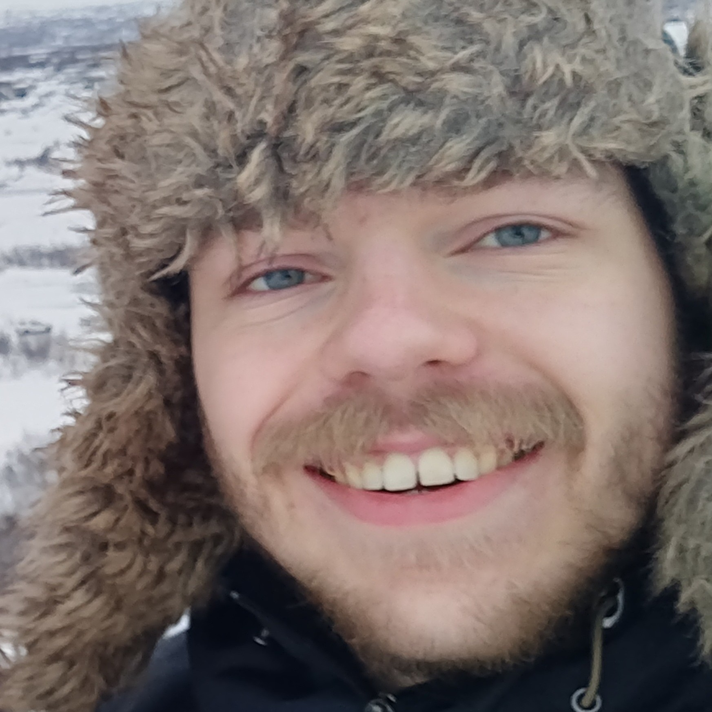
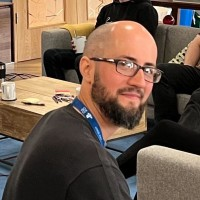

[sumo]: 
[braise]: 
[qr]: 
[heldritch]: 
[risingstar]: 

<section markdown="1">

# Hi, I'm Finlay
I'm a games programmer who believes in writing clean code and making my code *work* for others. I enjoy making good tools, fixing tricky bugs, finding new methods, and working with other skilled professionals to bring ideas into reality.

I am confident in my C++ and Unreal Engine 5 skills, with professional experience at Sumo Digital and 1st class honours in BSc (Hons) Computer Games Technology at Abertay. I have made mods, participated in game jams, the Grads in Games Rising Star Programming challenge, and Abertay’s DARE Academy.

I like indie games, reading sci-fi/fantasy, and learning about physics and science. Some games that inspire me today: Deltarune, Sifu, Outer Wilds, Celeste, and Hardspace: Shipbreaker.

I'm looking for work as a games programmer either locally in Dundee or remote. I can also work hybrid in Edinburgh, depending on the details.
</section>

[⇓ Download CV ⇓](assets/downloads/about/FinlayLaidlaw_CV.pdf){:.button-link}

<section markdown="1">

## C++
* Modern C++, up to C++23
* Using the standard library
* Safe memory management with smart pointers
* Error handling with expected or exceptions 
* Clean coding practices (encapsulation, DRY, good names, etc.)
* Learning and integrating new libraries as needed
* If you want to see some of my code, [look here](https://github.com/CyborgCabbage/yournespal).

</section>
<section markdown="1">

## Unreal Engine 5
* 3Cs: Enhanced Input and Mover
* UI programming: Common UI, UMG, Editor Menu Extensions, and Slate
* Tools programming: implementing undo/redo support, integrating with RewindDebugger, and various minor debug features
* Multiplayer: C++ Game Framework (PlayerState, GameMode, etc.), RPCs, fixing networking bugs
* Architecture: Using Subsystems, using Actors and Actor Components, designing new systems.

</section>
<section markdown="1">

## Soft Skills
* Getting up to speed with an existing project and processes quickly
* Researching and learning new skills independently as needed
* Communicating with others to solve problems on large teams
* Using professional workflows: Jira, CI/CD, code review, and adhering to coding standards 
* Using a variety of resources to solve problems: documentation, blog-posts, reading source-code, learning new debug tools, testing to confirm expected behaviour

</section>
<section markdown="1">

## Engine Level
* Graphics programming: DirectX11, OpenGL, shader programming, compute shaders, shadow mapping, normal maps, instanced rendering.
* Scene and object management
* Low level networking
* Using physics, audio, input, and windowing libraries

</section>
<section markdown="1">

## Miscellaneous
* Some experience with Godot and Unity in game jams
* HTML, CSS, TypeScript and WebAssembly

</section>

<figure class="quote">

<blockquote markdown="1">
Finlay is a fantastic programmer to work with. He's got a great attitude, is extremely fast and capable at prototyping, and isn't afraid to speak up and make suggestions to improve the features he is working on. He's also really engaged and delivers work extremely quickly. 

I'd happily work with Finlay again in the future, and have no doubt he has a bright future ahead of him in the games industry.

  —Thomas Chase, Senior Principle 3Cs Designer at Sumo Digital Sheffield
</blockquote>
</figure>




<h1>{{ post.title }}</h1>

<section class="project-thumbnail">

</section>
<section markdown="1" class="project-summary">
{{ post.summary }}
</section>

<a href="{{ post.url }}" class="button-link">Find out more ➔</a>



